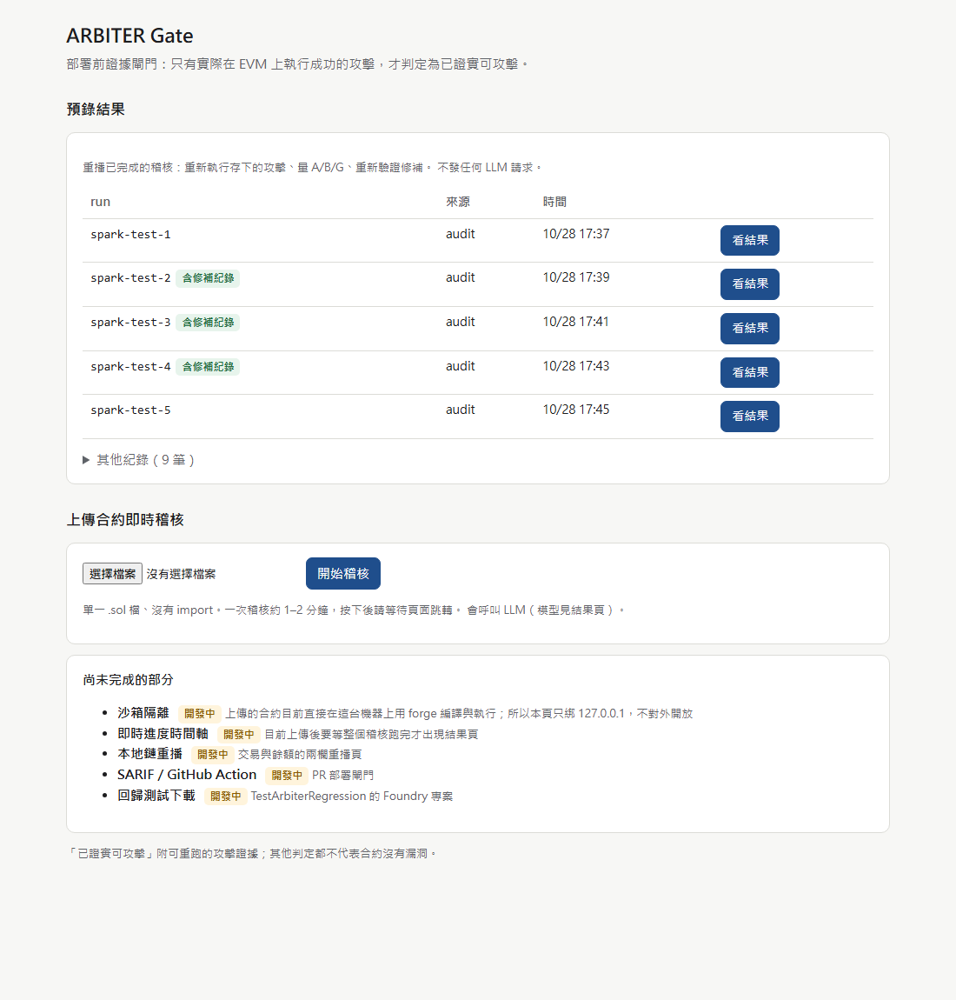
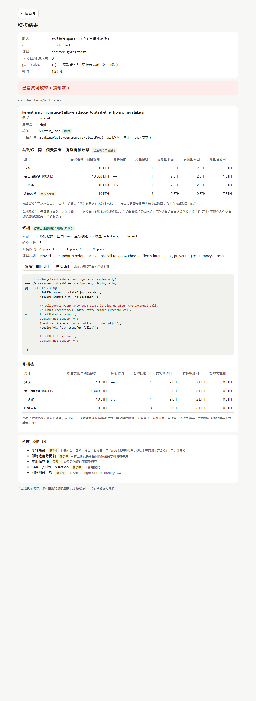

# 為什麼 hermetic 即時稽核都用 eth_profit（＋結果頁用語小修）

- 日期：2026-10-28
- 模型：**arbiter-gpt:latest**（gpt-oss 120B，Ollama on DGX Spark），temperature 0.0（`Gateway.chat` 預設，agent 沒有另外指定）
- 分支：`innoserve-gate`；forge 1.8.6
- 第一部分只查、不修：agent.py、tools.py、gate.py 都沒有改。第二部分只改 `web.py` 的顯示。
- 原始輸出：`reports/eth_profit_cause/`（實驗 stdout、gate.json、截圖）

> 本報告數字只屬於 arbiter-gpt，不可與 AIS3 時期 nemotron 的數字混用。

## 結論（先講）

**hermetic 和 repo 兩種模式，模型第一回合收到的 system prompt 與 tool schema 完全相同，唯一的差異是 user 訊息。** hermetic 的 user 訊息比較短，沒有 REPO_BRIEF，location 寫的是 `src/Target.sol`。在 temperature 0 下，這個差異讓模型第一次呼叫 `run_exploit` 時，**每一次**都選 eth_profit（hermetic 5/5），repo 模式則每一次都選 victim_loss（repo 8/8）。

模型在 hermetic 選 eth_profit 前寫的推理是：「Use victim_loss? The attacker will be the victim? … That's token_profit (ether). **Use eth_profit predicate: attacker ends with more ether than honest path.**」這句話的用詞直接對應到 `run_exploit` 工具說明裡的「eth_profit (attacker ends up with more ether)」和 `honest_body` 的說明。eth_profit 被接受，是因為 `_run_exploit` 不檢查謂詞在不在 schema 的 enum 裡。

| 判斷 | 證據強度 |
|---|---|
| 差異來自 user 訊息（REPO_BRIEF＋location），不是 system prompt、schema 或 NUDGE | **強**：程式碼重建確認 system 與 schema 相同；ledger 第一回合 prompt token 是 hermetic 4965、repo 5248，差 283，正好是 REPO_BRIEF 加 location 的長度；13 次稽核裡 NUDGE 0 次觸發 |
| hermetic 模式下模型會穩定地第一次就選 eth_profit | **強**：5/5（2 次舊紀錄＋3 次新實驗），第一回合推理文字逐字相同 |
| 模型選 eth_profit 的字眼來自 `run_exploit` 的工具說明 | **中**：推理用詞和工具說明的措辭對得上；system prompt 完全沒提 eth_profit（0 次），整份 schema 也只有這一處提到 |
| REPO_BRIEF 和 location 字串哪一個才是關鍵 | **未知**：要做消融實驗，必須改提示或改程式，這次沒做 |
| 為什麼 REPO_BRIEF 會讓模型改選 victim_loss | **未知**：REPO_BRIEF 本身完全沒提謂詞，推測是較長的上下文改變了推理路徑，未驗證 |

## 一、比較：第一回合送給模型的內容

### 相同的部分
- **system prompt**：同一份 `SYSTEM_PROMPT`（agent.py:35）。它提到 victim_loss 3 次、token_profit 1 次、eth_profit **0 次**，而且明講「victim_loss is the one you will almost always want」。
- **tool schema**：同一份 `tool_schemas()` 預設值（兩種模式都沒有傳 `predicates`）。
  - `run_exploit.predicate` 的 `enum` 只有 `["victim_loss", "liveness_broken"]`。
  - 但 `run_exploit` 的**說明文字**（tools.py:224 附近）寫的是：「Predicates: eth_profit (attacker ends up with more ether), token_profit (…), state_change (…), or liveness_broken (…)」，**完全沒提到 victim_loss**。
  - `honest_body` 的說明寫「REQUIRED for every predicate … For a profit predicate your …」，延續舊的差額式謂詞概念。
  - 整份 schema 裡 eth_profit 出現 1 次（就是上面那句說明），victim_loss 出現 3 次（enum、victim_enter／victim_exit 的說明）。

### 不同的部分：user 訊息（agent.py `USER_TEMPLATE`＋`REPO_BRIEF`）
用程式碼重建兩種模式的 user 訊息再做 diff，只有兩處不同：
```
-Audit the contract at src/Target.sol.
+Audit the contract at StakingVault.sol.
@@ 檔尾 @@
+This contract is part of the repository `examples`, and it is compiled in that repository's own context: ...
+(REPO_BRIEF 全文：list_repo_files／read_repo_file／grep_repo、constructor 參數、imports 用法)
```
- 長度：hermetic 1140 字元，repo 2447 字元。
- ledger 第一回合 `prompt_tokens`：hermetic **4965**（5 次全部一樣）、repo **5248**（8 次全部一樣），相差 283 token。
- REPO_BRIEF 裡**沒有任何一個謂詞名稱**。

### NUDGE_TO_EXPLOIT 有沒有觸發？ → 沒有（13/13）
`NUDGE_TO_EXPLOIT`（agent.py:282，內容含「pick eth_profit or state_change」）只在 `turn >= max_turns // 3`（16 // 3 = 5）而且**還沒呼叫過 run_exploit** 的情況下才送出。這 13 次稽核第一次呼叫 run_exploit 都在第 0 或第 1 回合，所以 NUDGE 一次都沒觸發。顧問的這條線索不是這次的原因，不過它確實是一段會把模型導向 eth_profit 的提示，可能在其他合約上造成影響。

### 模型第一次選 eth_profit 之前看到、寫下的文字
hermetic 5 次第一回合的推理文字（trace 只存前 2000 字元）完全相同，關鍵段落：
> … Need to test with run_exploit. **Use victim_loss? The attacker will be the victim? Actually attacker steals from contract, victim is the contract's owner?** The contract holds totalStaked. Attacker can drain all ether. That's token_profit (ether). **Use eth_profit predicate: attacker ends with more ether than honest path.** Honest path: a normal …

repo 模式 spark-test-2～5 第一回合的推理文字也完全相同：
> … So victim loss: other users lose their stake. We need to confirm if any guard prevents reentrancy: none. So exploit works. **We need to write run_exploit with victim_loss predicate.**

也就是說，hermetic 模式下模型其實有考慮 victim_loss，但沒想清楚誰是受害者，最後回到工具說明裡「attacker ends up with more ether」的定義。

## 二、小實驗：hermetic 3 次、repo 3 次（新 run-id）

先跑 `api_smoke.py`：`PASS: gateway at http://localhost:11434/v1 replied AIS3_OK`。

| run-id | 模式 | 第一次謂詞 | 所有 run_exploit 的謂詞（回合） | 判定 | 證實用的謂詞 | 請求 | 耗時 |
|---|---|---|---|---|---|---|---|
| predexp-herm-1 | hermetic（gate --file） | **eth_profit** | eth_profit(0) | 已證實 | eth_profit | 3 | 56 秒 |
| predexp-herm-2 | hermetic | **eth_profit** | eth_profit(0) | 已證實 | eth_profit | 5 | 56 秒 |
| predexp-herm-3 | hermetic | **eth_profit** | eth_profit(0) | 未發現可證明攻擊（conclude_safe） | — | 3 | 145 秒 |
| predexp-repo-1 | repo（cli audit） | **victim_loss** | victim_loss(1,2,9)、liveness_broken(10,11,13)、**eth_profit(14,15)** | 未發現可證明攻擊（turn_budget_exhausted） | —（第 14 回合的 eth_profit PoC 有通過，但回合用完前沒有 submit） | 16 | 309 秒 |
| predexp-repo-2 | repo | **victim_loss** | victim_loss(1,2,3) | 已證實 | victim_loss | 7 | 155 秒 |
| predexp-repo-3 | repo | **victim_loss** | victim_loss(1) | 未發現可證明攻擊（conclude_safe） | — | 10 | 465 秒 |

- finish_reason=length：0 次。
- 第一次謂詞：**hermetic 3/3 eth_profit，repo 3/3 victim_loss**，和舊紀錄合計 hermetic 5/5、repo 8/8。
- repo 模式也可能用到 eth_profit：predexp-repo-1 在 victim_loss 失敗 3 次、liveness_broken 失敗 3 次之後，到第 14 回合自己改用 eth_profit。所以「repo 模式不會出現 eth_profit」不成立，只是第一次選擇不同。
- **對可靠度的影響（另一件事，要注意）**：這 6 次的證實率是 hermetic 2/3（都是 eth_profit）、repo **1/3**（victim_loss）。早上 spark-test 的 repo 是 4/5。同樣的設定、同樣的合約，repo 模式的 victim_loss 證實率在 13 次裡是 5/8，波動很大。決賽現場即時稽核要把這個當成風險。

## 三、可能的修法（使用者決定，這次都沒做）

| 修法 | 動到哪裡 | 預期效果 | 代價與風險 |
|---|---|---|---|
| A. `gate --file` 單檔也走 repo 模式（寫 `path`、`repo_root` 為檔案所在的暫存目錄） | 只動 gate.py | 模型收到的提示和 spark-test 相同，預期第一次選 victim_loss（8/8 的證據） | 不動核心；但修補與 A/B/G 目前只支援 hermetic，要靠 `exploit_from_row()` 把 repo 模式的 exploit 改指向 hermetic（StakingVault 這種無 import 的檔案已實測可行）。repo 模式的 victim_loss 證實率在這幾次只有 5/8 |
| B. 改 tools.py 的 `run_exploit` 說明文字，把 victim_loss 放第一個、拿掉或降級 eth_profit 等舊謂詞 | 核心 tools.py（只改字串） | 直接處理最可能的成因 | 動到核心，要重跑評估；舊的 AIS3 數字是用這份說明量的 |
| C. tools.py `_run_exploit` 拒絕不在允許清單裡的謂詞（回傳錯誤，請模型改用 victim_loss） | 核心 tools.py（判定邏輯） | eth_profit 不會再被接受 | 改判定規則；hermetic 下模型要多一輪才會改用 victim_loss，能不能成功未知 |
| D. 改 agent.py `NUDGE_TO_EXPLOIT` 的「pick eth_profit or state_change」 | 核心 agent.py | 這次沒觸發，對本問題沒有效果；只是避免其他情況被導向舊謂詞 | agent.py 規定一行都不能改 |
| E. 不改，照實標示（現況） | 無 | — | 即時 hermetic 稽核幾乎一定是寬鬆謂詞，畫面上沒有 A/B/G 和修補 |

若要在決賽前處理，**A 是唯一不動核心的選項**。建議先用 A 跑 3～5 次，確認第一次謂詞與證實率再決定。

## 四、第二部分：結果頁用語小修（只改 web.py）

- **「本金」欄的實際意思**：victim_loss 模板的 `arbTrial()` 先 `vm.deal(arbVictim, endow)`，再呼叫 `arbEnter()`（workspace.py 模板）。所以 `endow` 是測試在受害者**進場前**給受害者帳戶的 ETH 餘額，不是存進合約的金額；實際存多少由攻擊證明的 `victim_enter` 決定（StakingVault 的例子是 2 ETH）。欄名改成 **「受害者帳戶初始餘額」**，第 2 個環境改叫「受害者餘額 1000 倍」，表格下方加一句說明。
- **獲利來源說明**：A/B/G 表格下方加「攻擊者獲利可能來自合約中其他人的資金（例如部署時存入的 5 ether）；受害者是否受損看『無攻擊取回』和『有攻擊取回』的差。」括號裡的金額**不是寫死的**：web.py 從 gate.json 的 `input.results` 找到結果檔，讀該 PoC 的 `arbSetup()`，用 regex 取 `new X{value: …}` 的值；讀不到就省略括號。gate.json 沒有改。
- **首頁**：預錄清單只列 spark-test-1～5（依序），其他 9 筆收進「其他紀錄（9 筆）」摺疊區塊。

### 驗收
- 首頁：
- 預錄 spark-test-2：
  - 本次 LLM 請求數 0；說明句顯示「例如部署時存入的 5 ether」。
- 頁面用語（首頁＋spark-test-2 結果頁）：`CLEAR` 0 筆、`safe` 0 筆，「不等於安全」以外的「安全」0 筆。
- 合併前檢查：8 個 probe 結束碼全 0；patch_probe 5/5；live_attack PROVEN／`--patched` NOT PROVEN；agent.py、tools.py 與 `innoserve-base` 零差異；gate.py、verdict.py、patch.py、workspace.py 自 Step 2b（a842682）後零差異。
