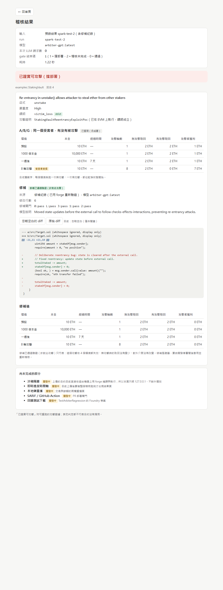
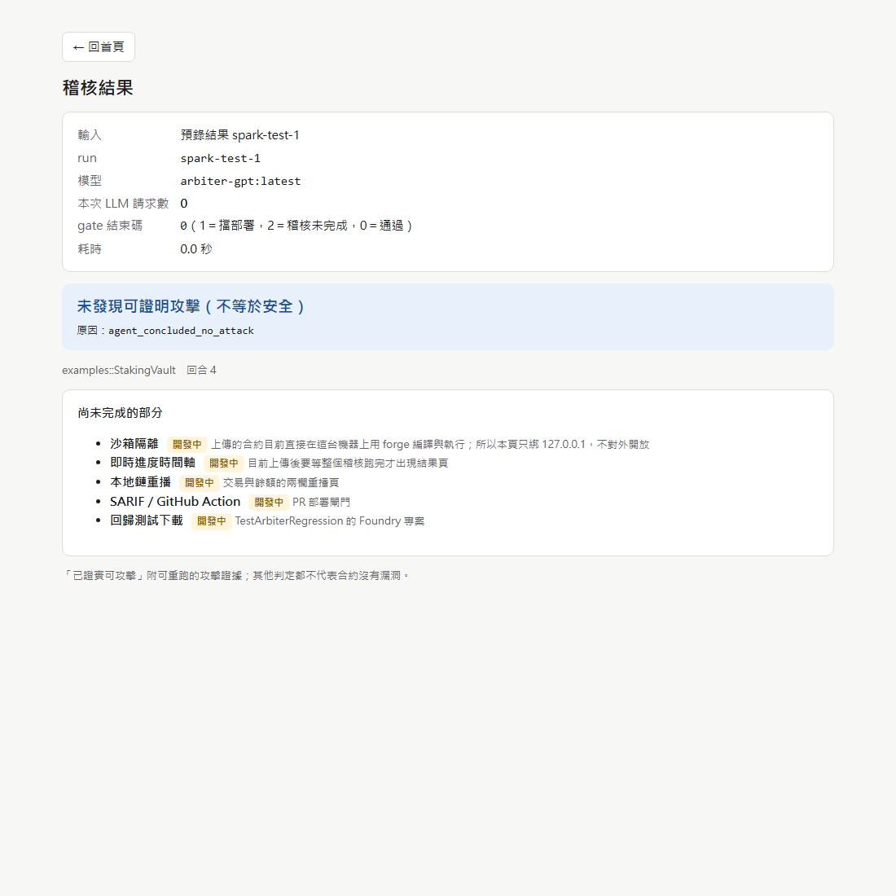
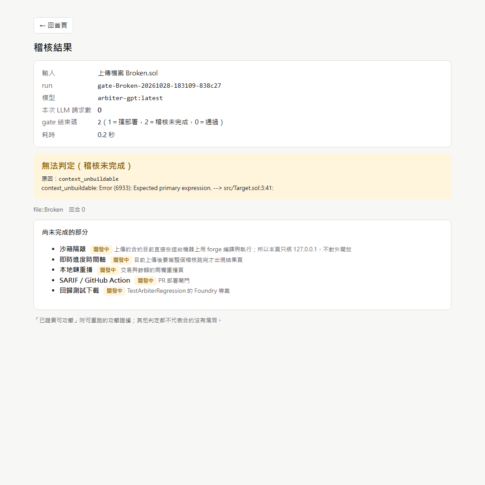
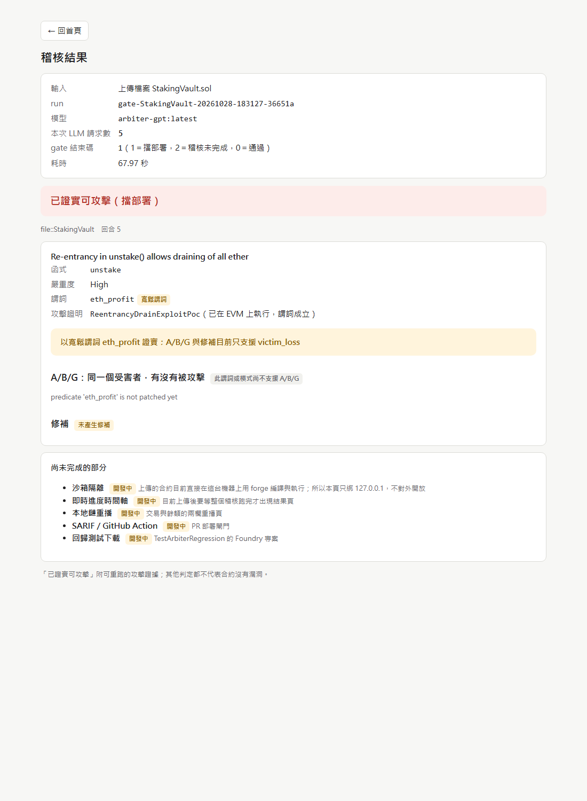

# Step 2b：最小上傳結果頁（＋ eth_profit 照實標示）

- 日期：2026-10-28
- 模型：**arbiter-gpt:latest**（gpt-oss 120B，Ollama on DGX Spark）
- 分支：`innoserve-gate`；forge 1.8.6；Python 3.14.4
- 截圖與 HTML 原始輸出：`reports/step2b/`（截圖用 Windows Edge headless，從 WSL 連 127.0.0.1:8765）

> 本報告數字只屬於 arbiter-gpt，不可與 AIS3 時期 nemotron 的數字混用。

## 一、eth_profit：照實標示（使用者決定，不改判定規則）

- gate.json 每個已證實的 finding 多了 `predicate_strict`（`predicate in tools.STRICT_PREDICATES`，直接 import，沒有另列一份）與 `predicate_note`。
- 非 strict 時判定維持 `proven_exploitable`，顯示「以寬鬆謂詞 eth_profit 證實；A/B/G 與修補目前只支援 victim_loss」。
- `tools.py`、`verdict.py` 沒有動。

**更正 Step 2a 報告：** Step 2a 寫「模型沒有帶 `predicate` 參數，`tools.py:789` 預設成 eth_profit」，**這是錯的**。當時只看了參數的前 200 個字元就下結論。重新完整檢查後，兩次即時稽核模型都**明確傳了 `"predicate": "eth_profit"`**。
正確的機制：工具 schema 的 `enum` 只列 STRICT 謂詞（victim_loss、liveness_broken），但 `_run_exploit` 不檢查傳入的值在不在允許清單裡，所以 eth_profit 照樣被組裝、執行並判為 adjudicated。`tools.py:789` 的預設值只在完全沒帶參數時才用到，這兩次都沒用到。

| 即時稽核 | 模式 | 謂詞 | 如何得到 |
|---|---|---|---|
| Step 2a `gate --file`（18:20） | hermetic | eth_profit | 模型明確傳入 |
| Step 2b 網頁上傳（18:31） | hermetic | eth_profit | 模型明確傳入 |
| spark-test-1～5（`cli.py audit`） | repo | victim_loss（2～5 證實；1 未證實） | 模型明確傳入 |

目前 hermetic 即時稽核 2/2 用 eth_profit，repo 模式 5/5 用 victim_loss。樣本很少，原因還沒查（兩種模式給模型的提示不同是一個可能）。11/3 可靠度測試要把 victim_loss 和非 strict 的證實次數分開統計。

## 二、Step 2b：最小上傳結果頁

`python3 -m arbiter.web [--port 8765]`（新檔 `arbiter/arbiter/web.py`）

- 只用標準函式庫（`http.server`、`email.parser` 解析 multipart；Python 3.13 起已沒有 `cgi`），**只綁 127.0.0.1，而且不能改**。實測 `ss -ltnp`：`127.0.0.1:8765`。
- 網頁只做一件事：呼叫 `python3 -m arbiter.gate`（子程序，一次一個 job），再把 gate.json 渲染成頁面。結果存在 `runs/gate/web/<id>.json`，以 `/result/<id>` 顯示（重新整理不會重跑）。
- 入口 (a) 預錄結果：列出 `runs/*.results.jsonl` 與 `runs/gate/*/` 的結果檔，有同名 `patches.jsonl` 就標「含修補紀錄」並一起帶入 `--patches`。只接受清單裡的 run_id。
- 入口 (b) 上傳單一 `.sol`：上限 256 KB，檔名清理後存到 `runs/gate/uploads/<id>/`，同步呼叫 `gate --file`，畫面寫明「約 1–2 分鐘」。
- 結果頁：
  - 判定用語直接取 `verdict.LABELS`。
  - A/B/G 4 個環境表格，欄名「無攻擊取回／有攻擊取回／攻擊者獲利」，環境名稱「預設／1000 倍本金／一週後／8 輪攻擊」，B < A 的環境標「受害者受損」。
  - 修補 diff 預設顯示 `diff_ignore_whitespace`，按鈕切換原始 diff；也顯示修補後的 A/B/G 與修補閘門結果。
  - 列出模型名稱、本次 LLM 請求數、gate 結束碼、耗時。
  - 「尚未完成的部分」標「開發中」：沙箱隔離、即時進度時間軸、本地鏈重播、SARIF／GitHub Action、回歸測試下載。沒有示意畫面。

### gate.py 的另一個改動：hermetic 編譯預檢

run.py 只有在 repo 模式才先檢查目標能不能編譯（`prepare_context`）。hermetic 的單檔合約如果編不過，會直接進 agent 迴圈、花掉 LLM 請求，最後落在「未發現可證明攻擊」。
依計劃 7.6（`context_unbuildable` → 無法判定），gate 在呼叫 run_arbiter 之前先用 `Workspace.context_ok()` 編譯一次；編不過就直接判「無法判定（稽核未完成）」，附 solc 的第一個錯誤與位置，0 個 LLM 請求。這是 gate 的輸入準備，`verdict.py` 的對應沒有變。

## 驗收

### 1. 預錄 spark-test-2：判定、A/B/G、修補 diff 都出現，0 個 LLM 請求 ✅

- 判定：已證實可攻擊（擋部署）；謂詞 victim_loss（strict）。
- A/B/G：2/2/1、2/2/1、2/2/1、2/0/7（8 輪攻擊標「受害者受損」）；修補後 2/2/0 ×4。
- 修補：修補已通過驗證（針對此攻擊），修補紀錄已用 forge 重新驗證，閘門 0/L/3/1/2 全 pass。
- **本次 LLM 請求數 0**；另外核對所有 ledger 檔總行數，重播前後都是 28 行。

### 2. 預錄 spark-test-1：顯示「未發現可證明攻擊（不等於安全）」✅

原因欄位是中性代碼 `agent_concluded_no_attack`。

### 3. 上傳編不過的合約：「無法判定（稽核未完成）」與原因 ✅

上傳 `Broken.sol`（`uint256 x = ;`）。原因：`context_unbuildable: Error (6933): Expected primary expression. --> src/Target.sol:3:41:`，0 個 LLM 請求，gate 結束碼 2。

### 4. 即時上傳 StakingVault 1 次（新 run-id）
先跑 `api_smoke.py`：`PASS: gateway at http://localhost:11434/v1 replied AIS3_OK`。

| 項目 | 結果 |
|---|---|
| run-id | `gate-StakingVault-20261028-183127-36651a`（網頁自動產生，新的） |
| 判定 | 已證實可攻擊（擋部署），gate 結束碼 1 |
| **謂詞** | **eth_profit（寬鬆謂詞）**，模型明確傳入；畫面顯示「以寬鬆謂詞 eth_profit 證實；A/B/G 與修補目前只支援 victim_loss」 |
| 證明 | `ReentrancyDrainExploitPoc`，回合 5 |
| LLM 請求數 | 5 |
| 耗時 | 68 秒（gate 67.97 秒） |
| A/B/G | 此謂詞或模式尚不支援 A/B/G |
| 修補 | 未產生修補 |

### 5. 頁面用語檢查（`reports/step2b/*.html`：首頁＋4 個結果頁）✅
- `CLEAR`（整字）：0 筆；`safe`（整字，不分大小寫）：0 筆。
- 「安全」：1 筆，就是 spark-test-1 的「未發現可證明攻擊（不等於安全）」；「不等於安全」以外 0 筆。
- 不分大小寫的 `clear` 只命中合約原始碼註解 `state is cleared`（spark-test-2 的 diff）。

### 6. 合併前檢查 ✅
- 8 個 probe 結束碼全 0；`patch_probe.py` 5/5 as expected
- `live_attack.py`：PROVEN；`--patched`：NOT PROVEN
- `agent.py`、`tools.py`：和 `innoserve-base` 零差異；`verdict.py`、`patch.py`：Step 2a 之後零差異
- `workspace.py`：88aba8b（`run_poc` 的加法）之後零差異

## 已知限制

- diff 切換按鈕是頁內 JavaScript；截圖只拍到預設的「忽略空白」狀態，沒有自動化測試點擊。
- 首頁的預錄清單會列出 runs/ 裡所有結果檔，包括早期的 `audit` 這種臨時 run；決賽前要清理，或只留要展示的 run。
- 上傳後要等整個稽核跑完（同步），中間沒有進度；即時時間軸屬 Step 3。
